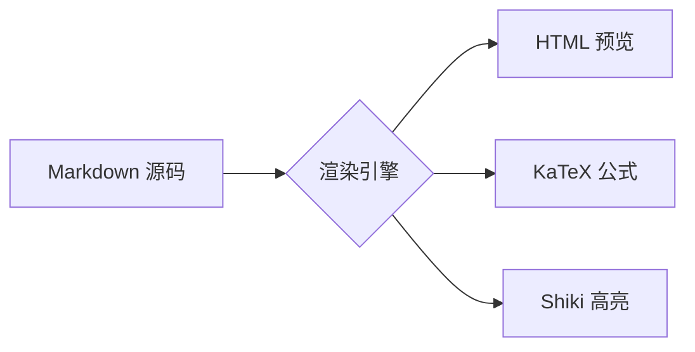

# MarkDownReader 渲染样例

[TOC]

## 基础语法

正文段落，中英文混排（Markdown 与 KaTeX 公式 $E = mc^2$ 同行渲染），全角标点："引号"、书名号《操作系统》，以及**粗体**、*斜体*、~~删除线~~、==高亮==、上标 X^2^、下标 H~2~O、`行内代码`、[链接](https://github.com/wyz1982/markdownreader) 与自动链接 www.github.com。

> 引用块：一个轻量级 Markdown 编辑器 + 阅读器。
> 这是引用的第二行。

### 列表

1. 有序列表项一
2. 有序列表项二
   - 嵌套无序项
     - 再嵌套一层

### 任务列表

- [x] 支持 CommonMark 规范全部语法
- [x] GFM 表格 / 删除线 / 自动链接
- [ ] 编辑器分栏同步（M3）

## 扩展语法

### 数学公式（KaTeX）

行内公式 $a^2 + b^2 = c^2$ 与块级公式：

$$
\int_{-\infty}^{\infty} e^{-x^2}\,dx = \sqrt{\pi}
$$

转义测试：这本书单价 \$5，反斜杠让美元符号保持字面量。

### 代码高亮（Shiki）

```ts
// TypeScript 示例
interface User {
  name: string;
  age: number;
}

export function greet(user: User): string {
  return `你好，${user.name}！`;
}
```

```python
# Python 示例
def fib(n: int) -> int:
    return n if n < 2 else fib(n - 1) + fib(n - 2)

print([fib(i) for i in range(10)])
```

### Mermaid 图表



### 提示容器

::: tip
这是一个 tip 容器，适合放小技巧和最佳实践。
:::

::: warning 自定义标题
warning 容器支持自定义标题，颜色按类型区分。
:::

### 表格（GFM）

| 语法 | 状态 | 说明 |
| :--- | :--: | ---: |
| 表格 | ✅ | 支持三种对齐 |
| 公式 | ✅ | KaTeX 渲染 |
| 图表 | ✅ | Mermaid 懒加载 |

### 脚注

这里有一个脚注引用[^1]，还有一个长脚注[^long]。

[^1]: 简短脚注内容。

[^long]: 长脚注可以包含多个段落。

    这是长脚注的第二段。

### 定义列表

Markdown
: 一种轻量级标记语言。

渲染引擎
: 将源码转换为富文本展示的核心模块。

### 其他

Emoji：:tada: :rocket: :smile: · 内嵌 HTML：<kbd>Ctrl</kbd> + <kbd>S</kbd> 保存 · 分隔线：

---

## 中文排版专项

中英文混排时的间距、全角标点的呈现、行内代码与汉字的衔接，都是「完美渲染」的关键细节。这是一段较长的中文文本，用于观察行高、段距与标点悬挂是否符合阅读预期，包括与 English words 的交替出现场景。
